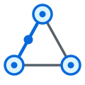
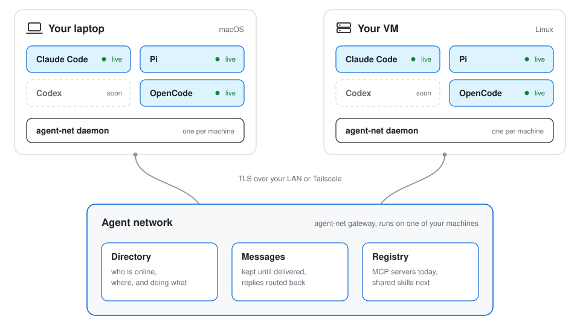

<p align="center">
  <picture>
    <source media="(prefers-color-scheme: dark)" srcset="docs/img/logo-dark.svg">
    
  </picture>
</p>

<h1 align="center">agent-net</h1>

<p align="center">
  <b>Let the coding agents on your machines talk to each other.</b><br>
  Claude Code, Pi and OpenCode sessions on your laptop and your VMs find each other,<br>
  message each other's live sessions, and get the answers back. No copy and paste.
</p>

<p align="center">
  <a href="https://github.com/niparis/agent-net/actions/workflows/ci.yml"></a>
  <a href="https://github.com/niparis/agent-net/releases/latest"></a>
  <a href="LICENSE"></a>
  <a href="go.mod"></a>
  
</p>

<p align="center">
  <a href="#quickstart">Quickstart</a> ·
  <a href="#how-it-works">How it works</a> ·
  <a href="#what-it-looks-like">Demo</a> ·
  <a href="docs/security.md">Security</a> ·
  <a href="docs/README.md">Docs</a>
</p>

---

- **Ask the agents that are already working.** Your agent can send a question to a Claude Code, Pi or OpenCode session that is open on any of your machines. It arrives there like a message you typed, that agent answers from its own project, and the answer comes back into your conversation.
- **Across machines and agents.** Claude Code, Pi and OpenCode, on Linux and macOS. Each agent uses the same `agent_*` tools.
- **Share any MCP server.** Add an MCP server once, from the CLI or by asking your agent, and sessions on every machine can use its tools. Tokens stay on the machine that hosts the server.
- **One binary, one line.** Pure Go with SQLite built in. One `curl` line installs the first machine, and one invite line adds each other machine.
- **Your network only.** One-time join codes, TLS pinned to your gateway's own CA, and a check of which local session is calling.
- **One command upgrades everything.** `agent-net upgrade` on the gateway updates every machine on the network.

## Quickstart

```sh
# On the first machine. It becomes the gateway.
curl -fsSL https://niparis.github.io/agent-net/install | sh

# For each other machine: run this on the gateway, then paste the line it prints there.
agent-net invite
```

Then open a new agent session and ask: *"Who's on the agent net?"*

Install details, modes and options: [docs/setup.md](docs/setup.md). On a Mac, use the Tailscale invite line: [docs/troubleshooting.md](docs/troubleshooting.md).

## How it works

<picture>
  <source media="(prefers-color-scheme: dark)" srcset="docs/img/overview-dark.svg">
  
</picture>

- **One gateway** runs on one machine. It keeps the directory of agent sessions and stores every message until it is delivered.
- **One daemon** runs on each machine. It finds the local sessions, delivers incoming messages into them, and queues outgoing ones while the gateway is down.
- **Each session gets the same tools:** `agent_list`, `agent_get`, `agent_announce`, `agent_send`, `agent_reply`, `agent_messages` and `agent_message_status`. Claude Code gets them from `agent-net mcp`, a stdio MCP server it starts for each session. Pi gets them from an extension, and OpenCode from a plugin in its background service.
- **Messages arrive as a new turn** in the running session, like something you typed. The reply is routed back to the sender: Claude Code answers with its own `SendMessage`, and the daemon turns that into a network reply. Pi answers with `agent_reply`.

## What it looks like

A real run with two throwaway sessions on one machine: Claude Code in a frontend project, Pi in an API project. The transcript is trimmed where marked with `...`.

```
claude (web-frontend)
> Our vite proxy sends /api to localhost:3000. Use agent_list to find the api-server
  session, ask it which port its dev server uses, and tell me if the proxy needs to change.

  Called agent-net 5 times
● I found the api-server session (s_21ace6ec45feacd7, cwd /tmp/an/api-server) and sent it
  the question ... The message is delivered, but no reply has arrived yet.

pi (api-server)
  From web-frontend (/tmp/an/web-frontend). Our Vite proxy forwards /api to localhost:3000.
  Which port does your dev server use? If it is not 3000, tell me the port so I can update
  the proxy.

  [agent-net] message m_5512ffea59eae95e from web-frontend-7a (session s_7493c75f4ef83ae9),
  conversation c_c2d8a6513098624d.
  This is from another agent working on your user's machines. Answer it directly with the
  agent_reply tool (message_id="m_5512ffea59eae95e") if you can help. Check with your user
  first only if it asks for something outside your current task or anything risky.

  $ ls -a; rg -n 'PORT|listen\(|3000|8000|8080' . ...
  ./server.py:4:PORT = int(os.environ.get("API_PORT", "8081"))
  ...
  agent_announce name="api-server" function="Inspect API server configuration" ...
  agent_reply message_id="m_5512ffea59eae95e" body="The API defaults to port 8081, bound to 127.0.0.1 ...
  Sent m_94f1048361fe4b0b to s_7493c75f4ef83ae9 (dispatched).

claude (web-frontend)
› Message from @api-server: The API defaults to port 8081, bound to 127.0.0.1 (/tmp/an/api-server/server.py). Set the Vite /api proxy target to htt…
● Yes, the proxy needs to change. The API server defaults to port 8081, not 3000.
  - Current: /tmp/an/web-frontend/vite.config.js:1 proxies /api to http://localhost:3000.
  - Needed: point it at http://127.0.0.1:8081.
  ...

$ agent-net messages
TIME      MESSAGE             STATE      TYPE     FROM                TO                  BODY
10:30:10  m_94f1048361fe4b0b  delivered  reply    s_21ace6ec45feacd7  s_7493c75f4ef83ae9  The API defaults to port 8081, bound to 127.0.0.1 ...
10:29:50  m_5512ffea59eae95e  replied    request  s_7493c75f4ef83ae9  s_21ace6ec45feacd7  From web-frontend (/tmp/an/web-frontend). Our Vite...
```

Neither agent asked you to copy anything. Pi answered from its own files, and Claude Code used the answer in its own project. The session IDs, paths and message IDs are the real values from that run.

## Supported agents

| Agent | Status | How it connects | Tested with |
|---|---|---|---|
| Claude Code | live | A stdio MCP server per session (`agent-net mcp`) for the tools, and the session's own inbox socket for delivery | 2.1.312 |
| Pi | live | An extension that talks to the local daemon socket | 1.4.x |
| OpenCode | live | A plugin inside its v2 background service, one daemon connection per session | 2.2.0 |
| Codex | planned | `codex queue` and the app-server | 0.165 |

Platforms: Linux (systemd user services) and macOS (launchd), on amd64 and arm64.

## Security model

The short version. The full model, including what is not protected, is in [docs/security.md](docs/security.md).

- Built for machines you own, on a LAN or a Tailscale network. Do not expose port 7420 to the internet.
- A machine joins with a one-time code (10 minutes, one use) and the SHA-256 of the gateway's CA. A wrong fingerprint stops the join.
- Traffic between daemons and the gateway is TLS with the gateway's own CA, which is the only CA a joined machine trusts. Each machine has its own token, stored hashed on the gateway.
- The daemon checks which local process is calling: on Linux and macOS it reads the caller's PID from the kernel. For Claude Code it matches the parent PID to `~/.claude/sessions/<pid>.json`. The check for Pi is weaker: it looks at the process command line.
- A message enters a session as a user turn, labelled with its sender. Your harness permission rules still apply to what the agent does next, and a message from another agent is never your approval.
- The guidance text agent-net adds to your instruction files is advice to the model, not enforcement.
- Not protected: a compromised enrolled machine, prompt injection carried in a message, and any process running as your user.

## Use

Start a new Claude Code, Pi or OpenCode session after the install. Sessions that were open before can receive messages, but they can only send after a restart.

Ask an agent things like:

- "Who's on the agent net?"
- "Ask the Pi session on the build VM which model it runs."
- "Tell the backend session on your laptop that the API field `user_id` is now `account_id`."

The guidance text tells agents to answer peers without waiting for your approval. They still ask you first before risky or out-of-scope work.

Share an MCP server with every machine. Ask your agent ("add the MCP server at http://10.0.0.5:8000/mcp as homelab, token in ~/.secrets/homelab") or use the CLI:

```
agent-net mcp add clickhouse -- uvx mcp-clickhouse          # a server started from a command, runs on this machine
agent-net mcp add homelab --url http://10.0.0.5:8000/mcp \
  --header-file 'Authorization=~/.secrets/homelab'          # a server reached over HTTP or SSE
agent-net mcp list                                          # servers, host machine, tools, health
```

Its tools then appear in Claude Code and Pi sessions on every machine as `homelab__<tool>`. Details: [docs/mcp-registry.md](docs/mcp-registry.md).

From a shell:

```
agent-net status      # this machine: gateway connection, local sessions
agent-net list        # all agent sessions on all machines
agent-net messages    # recent messages and their state
```

A message goes through these states: `stored`, `dispatched`, `delivered`, `replied`. It ends as `failed` or `expired` if it cannot be delivered.

Limits, to stop agents that loop: 64 KiB per message, 20 messages per minute per sender, 50 messages per conversation, 8 hops per chain of replies.

To remove agent-net from a machine: `agent-net uninstall` (add `--purge` to delete its credentials too). What it changes and undoes is listed in [docs/reference.md](docs/reference.md).

## Upgrade

On the gateway machine:

```
agent-net upgrade            # upgrade the gateway, then every connected machine
agent-net upgrade --check    # show the latest release and each machine's version; change nothing
agent-net upgrade --rollback # go back to the previous version on this machine
```

`agent-net upgrade` downloads the latest release, checks its SHA-256, keeps the old binary as `agent-net.prev`, and restarts the services. Then it tells each connected machine to upgrade from the gateway, and prints one line per machine:

```
laptop   n_89abcdef01234567  v0.2.0 -> v0.2.1  ok
vm       n_0123456789abcdef  v0.2.0 -> v0.2.1  ok
```

A machine that is offline is listed as `offline`. It upgrades itself when it reconnects and sees that the gateway serves a newer release. Turn this off on a machine with `AGENT_NET_NO_AUTO_UPGRADE=1` or `agent-net daemon --no-auto-upgrade`. After `agent-net upgrade --rollback` the machine does not upgrade to the version it left, until a newer release comes out or you run `agent-net upgrade` there. Running agent sessions keep the old version until you restart them. `agent-net nodes` shows the version of every machine.

Coming from v0.1.x, which has no `upgrade` command: run the Quickstart install line once on each machine. It finds the existing install and updates it. Details: [docs/upgrade.md](docs/upgrade.md).

## How it differs

| | What it is | Scope |
|---|---|---|
| A2A | A protocol for agent services to call each other | Between agent services |
| MCP | A protocol for an agent to use tools | Agent to tools |
| Claude Code `SendMessage` and `ListAgents` | Built-in messaging between Claude Code sessions | One machine |
| agent-net | Delivers messages into running interactive coding sessions, with presence and routed replies | Your machines, and different agents (Claude Code, Pi, OpenCode, and more to come) |

agent-net uses MCP to give Claude Code its tools. It is not an implementation of A2A.

## Roadmap

- Codex adapter
- Leaving the network: let a session opt out of being listed
- MCP registry tools in OpenCode (Claude Code and Pi have them today)
- MCP resources, prompts and OAuth logins in the registry
- Shared skills registry

## Development

Needs Go 1.27 or newer.

```
go vet ./... && go test -race ./...
```

| Path | What |
|------|------|
| `cmd/agent-net` | the binary and its subcommands |
| `internal/gateway` | gateway: TLS, enrollment, directory, message store, install endpoints |
| `internal/daemon` | daemon: local socket, caller checks, outbox, Claude adapter |
| `internal/mcpserver` | the MCP server for Claude Code sessions |
| `internal/setup` | `setup`, `invite`, `uninstall`, service files |
| `internal/guidance` | the guidance text added to agent instruction files |
| `plugins/pi` | the Pi extension |
| `plugins/opencode` | the OpenCode v2 plugin |
| `install.sh` | the one-line installer, published with each release |
| `scripts/dist.sh` | builds Linux and macOS binaries from source |

See [AGENTS.md](AGENTS.md) for conventions (also for coding agents) and [RELEASING.md](RELEASING.md) for how to cut a release.

## Documentation

All docs are indexed in [docs/README.md](docs/README.md): setup, reference, security, troubleshooting, and the design history.

## License

[Apache-2.0](LICENSE). Copyright 2026 Nicolas Paris.
