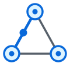
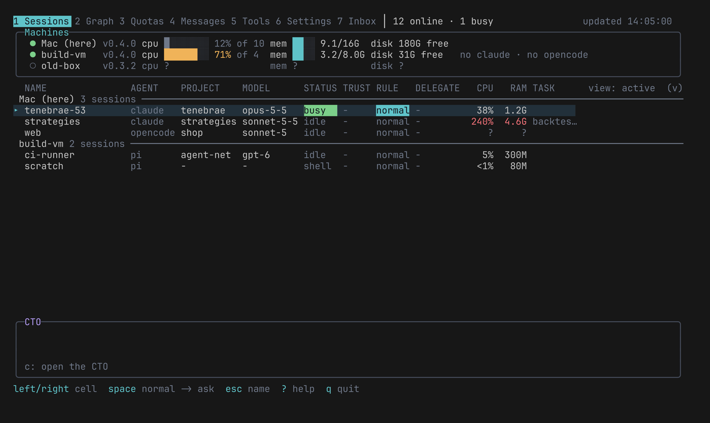
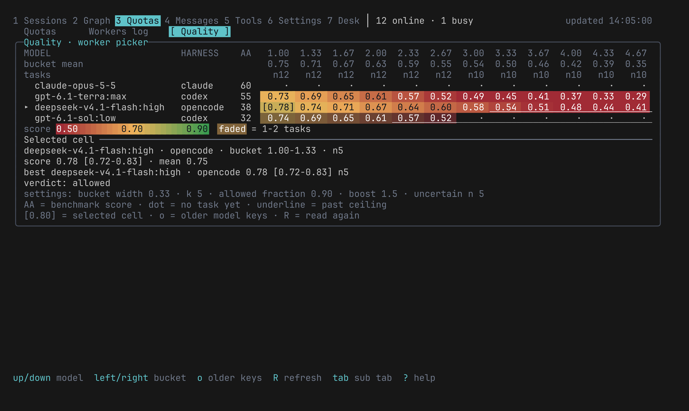
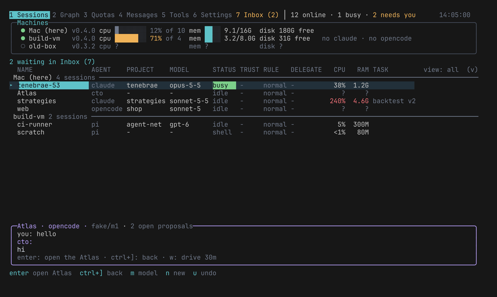
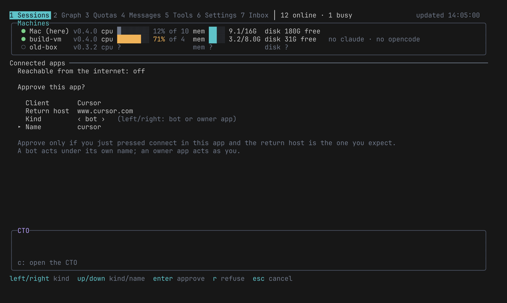
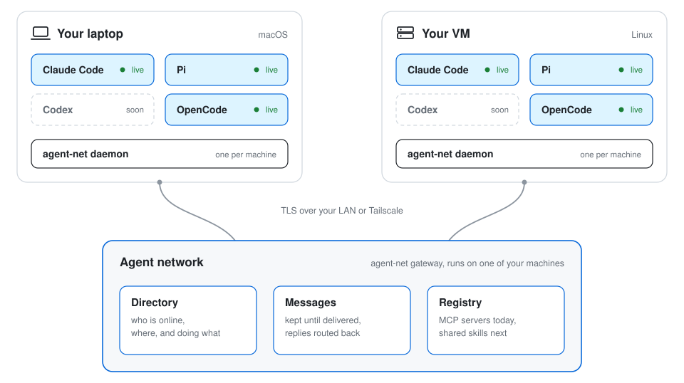

<p align="center">
  <picture>
    <source media="(prefers-color-scheme: dark)" srcset="docs/img/logo-dark.svg">
    
  </picture>
</p>

<h1 align="center">agent-net</h1>

<p align="center">
  <b>Run all your coding agents, on all your machines, from one place.</b><br>
  Claude Code, Codex, Pi, OpenCode and Antigravity sessions on your laptop and your VMs talk to each other,<br>
  hand work to cheaper workers, and wait for your decisions in one terminal view.
</p>

<p align="center">
  <a href="https://github.com/niparis/agent-net/actions/workflows/ci.yml"></a>
  <a href="https://github.com/niparis/agent-net/releases/latest"></a>
  <a href="LICENSE"></a>
  <a href="go.mod"></a>
  
</p>

<p align="center">
  <a href="#quickstart">Quickstart</a> ·
  <a href="#a-tour">Tour</a> ·
  <a href="#how-it-works">How it works</a> ·
  <a href="docs/security.md">Security</a> ·
  <a href="docs/README.md">Docs</a>
</p>

<p align="center">
  
</p>

---

- **Talk.** Your agent asks a question to a session that is already open on another machine, in another harness. It arrives there like a message you typed, that agent answers from its own project, and the answer comes back. No copy and paste.
- **Delegate.** An agent hands a task to a worker: a new session in its own git worktree. A judge scores how hard the task is, and agent-net picks a model that fits, from the subscriptions with quota left. The worker hands back a report with the facts.
- **Govern.** A map of your agents and the rules between them, a CTO agent that changes them on request, and one Inbox for every decision that needs you.

One Go binary with SQLite built in. One line installs the first machine, one line adds each other machine, and `agent-net upgrade` updates them all.

## Who is this for

**One person who runs many coding agents at once**, on a laptop and one or more VMs or servers, across repositories that depend on each other.

It fits when you:

- keep several agent sessions open, each on its own project or machine, and copy text between them by hand today;
- use more than one harness (Claude Code, Codex, Pi, OpenCode, Antigravity);
- want agents to hand coding work to cheaper models, and get a checked report back without watching;
- pay for several AI subscriptions and want them used evenly, not one exhausted while another sits idle.

It is not for teams (every machine belongs to one owner), untrusted machines (every enrolled machine is trusted), or a hosted service (you run the gateway yourself).

## Quickstart

```sh
# On the first machine. It becomes the gateway.
curl -fsSL https://niparis.github.io/agent-net/install | sh

# Then open agent-net.
agent-net
```

To add a machine, press `c` to open the CTO and ask it to add one. Paste the line it prints in a shell on the new machine. Make sure `~/.local/bin` is on your `PATH`; the install script prints the line to add if it is not.

Then open a new agent session and ask: *"Who's on the agent net?"*

Install details and options: [docs/setup.md](docs/setup.md). On a Mac, ask the CTO for the Tailscale install line: [docs/troubleshooting.md](docs/troubleshooting.md).

## A tour

`agent-net` opens the TUI. It has seven tabs: **1** Sessions, **2** Graph, **3** Quotas, **4** Messages, **5** Tools, **6** Settings, **7** Inbox. `?` lists the keys of the screen you are on.

### Sessions and messages

Every session on every machine, with its agent, project, model, status, CPU and memory. Enter opens a session live: its prompts, replies and tool calls. Messages (tab 4) shows what the agents say to each other.

Ask an agent things like:

- "Ask the Pi session on the build VM which port its dev server uses."
- "Tell the backend session that the API field `user_id` is now `account_id`."

The message enters the other session as a new turn, labelled with its sender, and the reply comes back into your conversation. Agents answer each other without waiting for you; they still ask you before risky or out-of-scope work. Per session, the RULE cell sets how requests from other agents are handled (`normal`, `ask` or `auto`), and the DELEGATE cell sets who does the coding: the session itself, a native subagent on a cheaper model, or workers. See [delegation policy](docs/reference.md#delegation-policy).

### Workers

Ask an agent to "do this with a worker". It calls `agent_worker_start` with a brief, and agent-net:

1. **Scores the brief.** A cheap judge rates six things (reasoning, scope, coupling, uncertainty, verification, risk) from 1 to 5. A fixed formula turns them into a level, from `trivial` to `very_complex`. The agent tells you the result in one line, and the Claude workers panel shows it next to the worker.
2. **Picks a model.** Among the worker profiles you registered, it keeps the ones good enough for that level, prefers providers that are behind their quota pace, keeps the protected ones (your orchestrator's subscription) for last, and rotates so no model takes every task.
3. **Starts the worker** in its own git worktree by default. Codex workers and Antigravity workers are sandboxed by their own sandboxes. On Linux, Pi and OpenCode workers run in bubblewrap when the project has the OS sandbox on (`workers.os_sandbox` in `node.json`). Otherwise Claude, Pi and OpenCode workers run with the owner's permissions. See the roadmap.
4. **Sends a notice** when the worker ends: status, run time, tokens, the branch and the diff stat, with the worker's report. The calling agent reviews the diff and runs the tests before it tells you the work is done.

Each task's outcome is recorded: nudges, fixes, and bugs found later. The Quality panel (tab 3, `d` for details) shows how much of the orchestrator's time each model costs per task, by level.

<p align="center">
  
</p>

Quotas (tab 3) also shows each subscription's usage and pace. Details: [workers](docs/reference.md#workers), [subscription quotas](docs/reference.md#subscription-quotas).

### The graph and the CTO

The Graph (tab 2) is the map of your agents: each project node has a charter (what it does, what it accepts and refuses), and edges set the rules between them. A `depends` edge says who may ask whom, and whether requests run without asking (`auto`), wait for you (`ask`) or are refused (`never`). A `deploys` edge lets one agent ship another's project.

The CTO is an agent that runs the network for you. Press `c` and ask it in plain words: add a machine, draft a charter, set an edge, start a worker. Small changes apply at once and show an undo key. Changes that widen what agents may do become proposals that wait for you.

### Inbox

<p align="center">
  
</p>

Everything that waits for you is in one place (tab 7): CTO proposals, sessions that ask you a question or stopped with work left, and written approvals. The tab shows the count. Select an item and approve or refuse it there. See [owner inbox](docs/reference.md#owner-inbox-and-written-approvals).

### Connected apps

Cloud agents (for example Grok Bot) and your phone can use agent-net through MCP over OAuth. The app shows a code; you approve it in the TUI (Settings, tab 6), as a **bot** that acts under its own name with a small set of tools, or as an **owner app** that acts as you. Internet access is off until you turn it on; with Tailscale, agent-net sets up the Funnel route for you.

<p align="center">
  
</p>

See [connected apps](docs/reference.md#connected-apps).

### Skills and MCP servers

Tools (tab 5) lists every skill and MCP server found on every machine, including the ones agent-net did not install. Turn one on for every project, for some projects, or for one machine; compare two copies of a skill and keep one; remove or restore. Filter with `node:`, `project:` or `machine:`, or press `t` on a node in the Graph to see what that agent gets. Every change is a plan you can undo. Details: [decision 0027](docs/decisions/0027-skills-and-mcp-management.md).

Add an MCP server once, and sessions on every machine can use its tools. Tokens stay on the machine that hosts it.

```
agent-net mcp add homelab --url http://10.0.0.5:8000/mcp \
  --header-file 'Authorization=~/.secrets/homelab'
agent-net mcp list
```

Its tools appear in every session as `homelab__<tool>`. Details: [docs/mcp-registry.md](docs/mcp-registry.md).

## How it works

<picture>
  <source media="(prefers-color-scheme: dark)" srcset="docs/img/overview-dark.svg">
  
</picture>

- **One gateway** runs on one machine. It keeps the directory of sessions, the graph, the worker records and every message until it is delivered.
- **One daemon** runs on each machine. It finds the local sessions, delivers messages into them, starts workers, runs the difficulty judge, and queues outgoing messages while the gateway is down.
- **Every session gets the same `agent_*` tools**: to find sessions, machines and projects, send and reply, announce its task, ask you a question, start, find, stop and rate workers, and read the graph. Claude Code and Codex get them from `agent-net mcp`; Pi uses an extension; OpenCode and Antigravity use plugins.
- **Connected apps** reach the gateway through a separate listener on `127.0.0.1:7422`, which is published on the internet only when you turn it on.

## Supported agents

| Agent | How it connects | Tested with |
|---|---|---|
| Claude Code | A stdio MCP server per session (`agent-net mcp`), and the session's own inbox socket for delivery. Setup also offers a plugin that shows the session's workers above the prompt. | 2.1.316 |
| Codex | A stdio MCP server per thread (`agent-net mcp --codex`); messages go through the shared Codex app server ([decision 0012](docs/decisions/0012-codex-peers.md)) | 0.166.0 |
| Pi | An extension that talks to the local daemon socket | 1.4.0 |
| OpenCode | A plugin inside its v2 background service | 2.2.0 |
| Antigravity (`agy`) | Plugin hooks and MCP for sessions, stream-json workers, and native skills | 1.4.12 |

Platforms: Linux (systemd user services) and macOS (launchd), on amd64 and arm64.

## Security model

The short version. The full model, including what is not protected, is in [docs/security.md](docs/security.md).

- Built for machines you own, on a LAN or a Tailscale network. Do not expose the gateway port (7420) to the internet.
- A machine joins with a one-time code (10 minutes, one use) and the SHA-256 of the gateway's CA. Traffic is TLS with the gateway's own CA, and each machine has its own token.
- The daemon checks which local process is calling, from the kernel's view of the caller's process.
- A message from another agent is never your approval. Owner-only changes need your action in the TUI.
- Connected apps: off by default. Each app is approved by you in the TUI with a one-time code, gets only its own tools, and is rate limited. Revoke it with `x`.
- The guidance agent-net adds to your instruction files is advice to the model, not enforcement.
- Not protected: a compromised enrolled machine, prompt injection carried in a message, and any process running as your user.

## Upgrade

```
agent-net upgrade            # on the gateway: upgrade it, then every connected machine
agent-net upgrade --check    # show the latest release and each machine's version
agent-net upgrade --rollback # go back to the previous version on this machine
```

A machine that was offline upgrades itself when it reconnects. Running Claude Code sessions switch to the new version by themselves, Pi needs `/reload`, and OpenCode reloads its plugin by itself. Details: [docs/upgrade.md](docs/upgrade.md).

To remove agent-net from a machine: `agent-net uninstall` (add `--purge` to delete its credentials too).

## How it differs

| | What it is | Scope |
|---|---|---|
| A2A | A protocol for agent services to call each other | Between agent services |
| MCP | A protocol for an agent to use tools | Agent to tools |
| Claude Code `SendMessage` | Built-in messaging between Claude Code sessions | One machine, one harness |
| agent-net | Messages into running interactive sessions, workers with model choice, and owner control | Your machines, five harnesses |

agent-net uses MCP to give agents their tools. It is not an implementation of A2A.

## Roadmap

- **Model choice from capability.** Match each model's measured capability to the task's raw difficulty score, corrected by how much review time its past work cost. Plan: [docs/design/model-capability.md](docs/design/model-capability.md).
- **An optional sandbox for every worker.** Linux is done for Pi and OpenCode workers: bubblewrap, switched on per project with `workers.os_sandbox` in `node.json`. Still to do: macOS (sandbox-exec, designed), and Claude workers, which are refused while the switch is on because `claude --bg` runs outside any wrapper (the plan is Claude Code's own sandbox settings). Codex and Antigravity keep their own sandboxes. Design: [docs/design/worker-os-sandbox.md](docs/design/worker-os-sandbox.md); plan: [docs/design/hardening-plan.md](docs/design/hardening-plan.md) W7.
- **A modular agent-net:** agent-net keeps the mechanisms, and a way of working (who does what, how work is tested and merged, what agents are told) becomes data at network, team, repo or agent level, which the CTO can propose to change. Plan: [docs/design/modularity.md](docs/design/modularity.md).
- **A named model is the exception.** When a session asks for a worker by model name instead of letting the picker choose, agent-net replies with a reminder that naming a model should be exceptional, and why the picker is the default.
- **Its own Tailscale name for agent-net**, so connected apps do not share a host name with other services.
- **The phone app.**
- MCP resources, prompts and OAuth logins in the registry.

## Development

Go 1.27 or newer. Build, test and conventions are in [AGENTS.md](AGENTS.md), for people and coding agents alike. Releasing: [RELEASING.md](RELEASING.md). All docs are indexed in [docs/README.md](docs/README.md).

## License

[Apache-2.0](LICENSE). Copyright 2026 Nicolas Paris.

## Credits

Model capability scores are from [Artificial Analysis](https://artificialanalysis.ai/).
