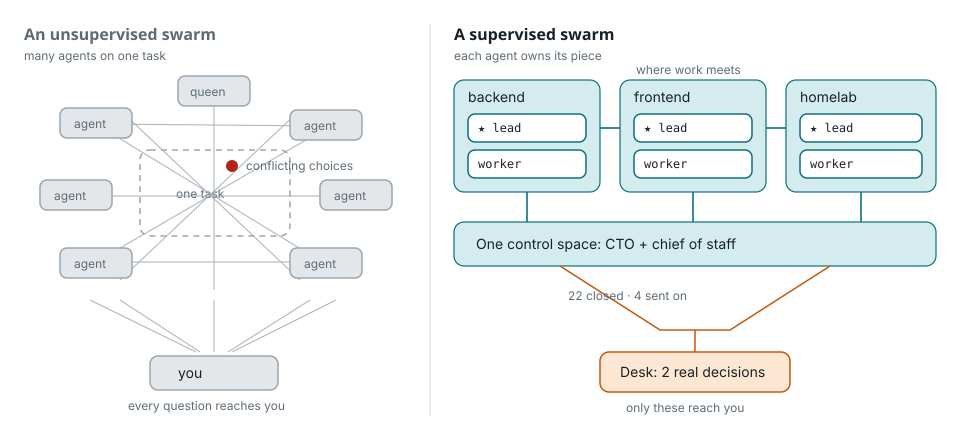
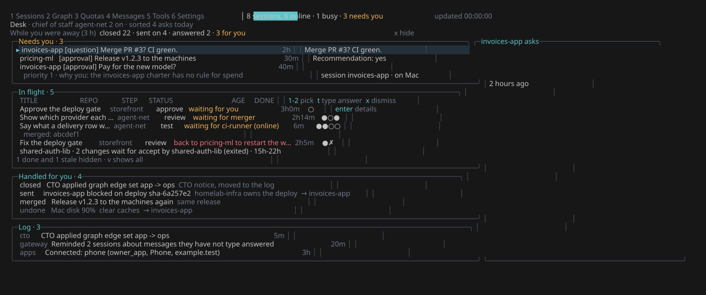

<p align="center">
  <picture>
    <source media="(prefers-color-scheme: dark)" srcset="docs/img/logo-dark.svg">
    
  </picture>
</p>

<h1 align="center">agent-net</h1>

<p align="center">
  <b>A supervised swarm for the coding agents you already run.</b><br>
  Many agents, each owning its piece. One control space. Only real decisions reach you.
</p>

<p align="center">
  <a href="https://github.com/niparis/agent-net/actions/workflows/ci.yml"></a>
  <a href="https://github.com/niparis/agent-net/releases/latest"></a>
  <a href="LICENSE"></a>
  <a href="go.mod"></a>
  
</p>

<p align="center">
  <a href="#quickstart">Quickstart</a> ·
  <a href="#background-sessions-the-swarm-runs-without-you-at-the-terminal">Background sessions</a> ·
  <a href="#workers-that-pick-themselves-and-get-better">Workers</a> ·
  <a href="#smart-defaults-and-you-can-change-almost-anything">Customise</a> ·
  <a href="#your-memory-the-swarm-learns-how-you-decide">Your memory</a> ·
  <a href="#several-machines-one-network">Several machines</a> ·
  <a href="#the-ideas">The ideas</a> ·
  <a href="#why-not-just">Why not just …</a> ·
  <a href="docs/tour.md">Tour</a> ·
  <a href="docs/security.md">Security</a> ·
  <a href="docs/README.md">Docs</a>
</p>

<p align="center">
  
</p>

<p align="center">
  <picture>
    <source media="(prefers-color-scheme: dark)" srcset="docs/img/swarm-dark.svg">
    
  </picture>
</p>

---

agent-net turns the Claude Code, Codex, OpenCode, Pi and Antigravity sessions on your laptop and your servers into one swarm. Each session owns a project. Leads answer for their teams. Workers take single tasks on the cheapest model that fits. Everyone follows the rules you write, and anything that needs you lands on one Desk.

### Your two supervisors

- **The CTO** runs the swarm on your instructions. Ask it in plain words to add a machine, write a charter, set a rule between two projects or start a worker. Every change it makes leaves an undo.
- **The chief of staff** reads every ask meant for you first. It closes what it can, sends the rest to the agent that should answer, and leaves only real decisions on your Desk.

<p align="center">
  
</p>

Both are yours to shape. You choose their role, harness, model and rules. For example, run the CTO in Claude Code on Opus with the standing order "never remove a machine without asking me", and the chief of staff in Codex on a small model with the rule "anything that costs money goes to the owner".

## What it is, and what it is not

It is:

- **One network for the agents you already use.** Your own interactive sessions, in five harnesses, on every machine you own.
- **A swarm with structure.** Charters say what each agent does and refuses. Teams have leads. Every change goes through accept, review, test, merge, release and verify, and each step has an owner.
- **Cheaper work.** A worker gets each task. A judge rates how hard it is, and agent-net picks a model that is good enough, from the subscriptions that still have quota.
- **One Go binary, self-hosted,** with SQLite built in. One line installs it.

It is not:

- an SDK or framework for building agents;
- a hive of agents working on one task;
- a hosted service;
- for teams of people or for machines you do not trust. Every machine belongs to one owner.

## Three stories

**A change in a shared library.** The session that owns `shared-auth`, a library two of your apps use, renames `user_id` to `account_id` and releases v2.3. It tells the sessions of both apps, one on your laptop and one on the build box. Each updates its code and replies with the commit. You read it all in Messages. You typed nothing.

**A bug fixed while you are away.** Your Mac's daemon hangs after an upgrade. The agent that owns agent-net writes a brief, and a worker on a cheaper model reproduces the hang and fixes it. Review, tests and the release run as steps. The next upgrade comes back by itself in 16 seconds.

**A deploy with a real approval.** The forge lead approves a deploy. A member asks the operator agent to deploy and quotes the approval. agent-net shows the operator the original message, so it deploys without asking again. You see one line in the log.

## Background sessions: the swarm runs without you at the terminal

Every session in the swarm can run in the background. You start it, wake it, steer it and stop it from agent-net, from any machine, without keeping a terminal open for it.

- **Start one anywhere.** Ask the CTO, or press a key in the TUI, to start a session in any project on any machine, with the harness, model, branch and first message you choose. Claude Code sessions run as background jobs of Claude's own service.
- **It wakes when it is needed.** A message to a session that went offline asks its machine to resume the same conversation, then delivers the message. Claude Code, Codex and OpenCode sessions wake this way; no new session is started.
- **It keeps working on its own clock.** Give a project a standing loop, for example every 4 hours, and its session is nudged with what changed since the last tick: new messages, finished workers, open asks. It does the next step and reports. Two ticks with no progress pause the loop and leave one question on your Desk.
- **You look in only when you want to.** Press Enter on any session to open it live, in herdr or your terminal. Stop, resume or restart it from the TUI, the web console or by asking the CTO.

Example. Before bed you tell the CTO: *"Start a Codex session in billing on the build box: migrate the invoice job to the new queue, use workers for the code."* The session plans the work, hands the code to two workers, reviews their reports and opens the pull request. At 3 a.m. the shared-auth session, also in the background, asks it whether billing is ready for the v2.3 token change; the billing session wakes, answers and goes back to sleep. In the morning your Desk holds one question: *"Merge PR #212? CI green. Recommended: yes."*

## Workers that pick themselves, and get better

You do not choose a model for each job. The swarm does, and it learns from every job it runs.

- **It sizes the job.** A small judge model reads the brief and rates it on six points (reasoning, scope, coupling, uncertainty, verification, risk). The result is a level, from trivial to very complex.
- **It picks a model and a harness.** From the worker profiles you registered, it keeps the models whose track record at that level is good enough. It prefers subscriptions that are behind their quota pace, keeps the ones you protect for last, and rotates so no model takes every job. Easy work goes to cheaper models.
- **It learns from the results.** Every worker's outcome is recorded: done or not, how much rework its caller needed, and defects found later. A model that does well at a level gets more of that work, and one that does badly gets less. About one pick in ten tries a model one level above its proven record, so the swarm finds out when a cheaper model has grown good enough.
- **It reads your playbook.** You can write a note for a model, such as *"Codex terra: give it the test command, it forgets to run it"*. The note travels with every brief for that model. agent-net also writes notes itself when the same lesson comes up in several sessions, and it never changes a note you pinned.

Example. A brief to fix a flaky test is judged normal. Three models qualify; the picker gives it to Gemini Flash because the Claude subscription is ahead of pace this week. The worker finishes in nine minutes and its caller rates it 3 of 5 for a sloppy report. Next week that model's normal-level score is a little lower, and a similar job may go elsewhere.

The Quality panel (TUI tab 3) shows each model's record by level, in minutes of the orchestrator's time per task.

## Smart defaults, and you can change almost anything

agent-net works the day you install it. A CTO, a picker, delivery steps and a Desk are all set up with defaults that fit one person running a handful of projects. When you want it to work differently, almost everything is a setting, a charter or a rule, and the CTO can change it for you in plain words.

| You can change | For example |
|---|---|
| The CTO | Its harness and model, its title, and its standing orders |
| The chief of staff | Which session plays the part, its model, and its charter |
| Charters | What each project does, accepts and refuses, and when it must ask you |
| Teams and leads | Who leads which projects, and whether members ask the lead or you |
| Rules between projects | Who may ask whom, and whether requests run, wait for you or are refused |
| Delivery steps | Who accepts, reviews, tests, merges, releases and verifies, per project |
| Worker choice | Registered models, protected subscriptions, level floors, playbook notes |
| Background behaviour | Wake on message, standing loops and their interval |

The defaults are conservative where it matters: nothing deletes data, spends money or touches secrets without you.

## Your memory: the swarm learns how you decide

Every time you decide something, agent-net keeps it, and the swarm uses it so it asks you less the next time.

- **Standing orders.** Lasting instructions you give the CTO in plain words, such as *"never deploy on Fridays"*. They survive restarts and machine changes, and every agent can read them.
- **Your answers.** Each answer you give on the Desk is stored with its question, its project and when you gave it.
- **Your corrections.** When the chief of staff brings you something you did not need to see, press `n` ("didn't need me"); when it handled something it should have asked you about, press `m`. Its next batches sort that kind of ask the way you showed it.
- **Used before asking.** Before an agent or the chief of staff asks you, it searches this memory (`agent_owner_judgments_find`). If you already answered the same kind of question, it acts on that answer and names it, instead of asking again.

Example. On Monday you approve homelab-agent's merge of an image-pin update and add *"approve image-pin merges in truenas-stacks"*. On Wednesday the same kind of merge comes up. homelab-agent finds Monday's answer, merges, and the Desk log shows one line citing it. Nothing reaches you.

The memory lives in your gateway's database, on your machine. Standing orders are listed in the TUI (Settings), where you add, remove or restore them; the CTO can do the same on your instructions.

## Several machines, one network

One machine runs the **gateway**. Every machine, the gateway's included, runs a small **daemon** that finds its local sessions, delivers their messages and starts their workers. Sessions on any machine can talk to sessions on any other, and the TUI on any machine shows them all.

Example: a MacBook you work on, plus a Linux box under the desk that runs long jobs.

1. On the Linux box, which stays on, run the install line from [Quickstart](#quickstart). It becomes the gateway.
2. In `agent-net` on the Linux box, press `c` and ask the CTO: *"Add my MacBook."* It prints one line, valid for 10 minutes and one machine:
   ```sh
   curl -fsSL -k --pinnedpubkey 'sha256//...' 'https://192.168.1.10:7420/install/ABCD2345' | sh
   ```
3. Paste it in a terminal on the MacBook. It installs agent-net, joins the network and starts the daemon. If the gateway is on Tailscale, the CTO also prints a line for its Tailscale address, so the laptop stays connected away from home.

Now a Claude Code session on the MacBook can ask the OpenCode session on the Linux box which port its dev server uses, and a worker for a laptop project can run on the Linux box. Add a third machine the same way. `agent-net upgrade` on the gateway upgrades every machine, and a machine that was offline catches up when it reconnects. Details: [docs/setup.md](docs/setup.md).

## Quickstart

```sh
# On the first machine. It becomes the gateway.
curl -fsSL https://niparis.github.io/agent-net/install | sh

# Then open agent-net.
agent-net
```

To add a machine, press `c` to open the CTO and ask it to add one. Paste the line it prints in a shell on the new machine. Make sure `~/.local/bin` is on your `PATH`; the install script prints the line to add if it is not.

Then open a new agent session and ask: *"Who's on the agent net?"*

Install details and options: [docs/setup.md](docs/setup.md). On a Mac, ask the CTO for the Tailscale install line: [docs/troubleshooting.md](docs/troubleshooting.md).

## The ideas

Nine words, in the order you meet them.

- **Session.** An agent in one of five harnesses, opened by you in a terminal or started by agent-net in the background. agent-net finds it, gives it tools, and can wake it when a message arrives. *"The Pi session on the build VM."*
- **Message.** One session asks another and gets the answer back in its own conversation. It arrives like a message you typed, labelled with its sender. *"Ask the billing session which port its dev server uses."*
- **Worker.** A new session started for one task, in its own git worktree. It hands back a report with the diff, the run time and the cost. *"Fix the flaky test with a worker."*
- **Charter.** A few lines per project: what it does, what it accepts, what it refuses, and when it must ask you. *"homelab-agent refuses to touch the encryption key."*
- **Team and lead.** Projects that belong together, with one session as their lead. Members ask the lead first, not you. *"The forge team's lead may merge its members' work."*
- **Steps.** A change moves through accept, review, test, merge, release and verify. Each step has an owner, and its evidence is recorded. *"The merger owns tests and merges; the caller verifies."*
- **Desk.** The one place where things wait for you: irreversible actions, money, secrets, and choices only you can make. Everything else is handled and logged. *"Buy 2 TB of backup space? Recommended: yes."*
- **CTO.** Your agent for running the network. *"Turn on lead merges for forge."*
- **Chief of staff.** Your agent for sorting what reaches you. *"Handled for you: 22 closed, 4 sent on, 2 for you."*

A guided tour of every screen is in [docs/tour.md](docs/tour.md).

## Why not just …

Other tools solve parts of this, and some of them may be all you need.

| Tool | What it does well | Where agent-net differs |
|---|---|---|
| **Claude Code messaging and agent teams** | Claude Code sessions message each other, also across machines, and a lead can run a team of Claude teammates. Built in, no install. | Claude Code only. Cross-machine traffic goes through Anthropic's servers with a claude.ai sign-in. agent-net covers five harnesses through your own gateway, and adds charters, steps and the Desk. |
| **Claude Squad, Conductor** | Run several coding agents in parallel, each in its own git worktree, from one terminal or one Mac app. Simple and fast to start. | They start new agents on one machine. agent-net joins the sessions you already have on every machine, and lets them talk and follow rules. |
| **OpenHands** | A self-hosted control center that runs coding agents, including Claude Code and Codex, in its own environments. | OpenHands launches and hosts the agents. agent-net connects the interactive sessions you are already working in, on your own machines. |
| **Devin, Cursor cloud agents, Factory** | Hosted agents that take a task and return a pull request. | Hosted and vendor-run. agent-net is self-hosted and mixes vendors, with you setting the rules. |
| **Swarm tools such as Ruflo (claude-flow)** | Many agents coordinate on missions, with a hive and a queen agent. | Many agents on one goal, led by an agent. agent-net is a supervised swarm: one agent per piece, with you as the owner. |
| **CrewAI, LangGraph, AutoGen, OpenAI Agents SDK, Google ADK** | Frameworks for building agent programs in code. | You write the agents there. agent-net uses agents that already exist and that you also use by hand. |
| **MCP and A2A** | Protocols: MCP gives an agent tools, and A2A lets agent services call each other. | agent-net uses MCP to give agents their tools. It is not an implementation of A2A. |

If you only use Claude Code on one machine, try its built-in messaging first. If you want many agents on one task in one repo, a parallel-agent tool is simpler. agent-net fits when you run many agents, across harnesses and machines, on projects that depend on each other.

## Isn't a swarm fragile?

The common criticism of multi-agent systems is right about one shape: many agents sharing one task, each missing the others' context and making choices that conflict (Cognition, "Don't build multi-agents"). It also costs many times the tokens (Anthropic measured about 15 times for its research system). A supervised swarm is built the other way.

- **Each agent owns its piece.** One session per project, or one worker per task, with its own context and its own git branch. Two agents do not edit the same thing at once.
- **Agents talk where their work meets.** When a change crosses projects, one session tells the other, the way two engineers on two services do. A worker gets a written brief and hands back a checked report, not a shared transcript.
- **Someone other than the author checks every change.** Accept, review, test, merge, release and verify each have an owner.
- **Cost is chosen.** Each task goes to the cheapest model that is good enough for it, spread across your subscriptions.
- **You supervise by exception.** Leads answer their members, the chief of staff sorts the rest, and only real decisions reach your Desk.

## How it works

<picture>
  <source media="(prefers-color-scheme: dark)" srcset="docs/img/overview-dark.svg">
  
</picture>

- **One gateway** runs on one machine. It keeps the directory of sessions, the graph, the worker records and every message until it is delivered.
- **One daemon** runs on each machine. It finds the local sessions, delivers messages into them, starts workers, runs the difficulty judge, and queues outgoing messages while the gateway is down.
- **Every session gets the same `agent_*` tools**: to find sessions, machines and projects, send and reply, announce its task, ask you a question, start, find, stop and rate workers, and read the graph. Claude Code and Codex get them from `agent-net mcp`; Pi uses an extension; OpenCode and Antigravity use plugins.
- **Connected apps** such as a cloud bot or your phone reach the gateway through a separate listener on `127.0.0.1:7422`, which is published on the internet only when you turn it on.

## Supported agents

| Agent | How it connects | Tested with |
|---|---|---|
| Claude Code | A stdio MCP server per session (`agent-net mcp`), and the session's own inbox socket for delivery. Setup also offers a plugin that shows the session's workers above the prompt. | 2.1.316 |
| Codex | A stdio MCP server per thread (`agent-net mcp --codex`); messages go through the shared Codex app server ([decision 0012](docs/decisions/0012-codex-peers.md)) | 0.166.0 |
| Pi | An extension that talks to the local daemon socket | 1.4.0 |
| OpenCode | A plugin inside its v2 background service | 2.2.0 |
| Antigravity (`agy`) | Plugin hooks and MCP for sessions, stream-json workers, and native skills | 1.4.12 |

Platforms: Linux (systemd user services) and macOS (launchd), on amd64 and arm64.

## Security model

The short version. The full model, including what is not protected, is in [docs/security.md](docs/security.md).

- Built for machines you own, on a LAN or a Tailscale network. Do not expose the gateway port (7420) to the internet.
- A machine joins with a one-time code (10 minutes, one use) and the SHA-256 of the gateway's CA. Traffic is TLS with the gateway's own CA, and each machine has its own token.
- The daemon checks which local process is calling, from the kernel's view of the caller's process.
- A message from another agent is never your approval. Owner-only changes need your action in the TUI.
- Connected apps: off by default. Each app is approved by you in the TUI with a one-time code, gets only its own tools, and is rate limited. Revoke it with `x`.
- The guidance agent-net adds to your instruction files is advice to the model, not enforcement.
- Not protected: a compromised enrolled machine, prompt injection carried in a message, and any process running as your user.

## Upgrade

```
agent-net upgrade            # on the gateway: upgrade it, then every connected machine
agent-net upgrade --check    # show the latest release and each machine's version
agent-net upgrade --rollback # go back to the previous version on this machine
```

A machine that was offline upgrades itself when it reconnects. Running Claude Code sessions switch to the new version by themselves, Pi needs `/reload`, and OpenCode reloads its plugin by itself. Details: [docs/upgrade.md](docs/upgrade.md).

To remove agent-net from a machine: `agent-net uninstall` (add `--purge` to delete its credentials too).

## Roadmap

- **The web console.** The Desk, sessions, changes and messages in a browser and on the phone, served by the gateway. Read and answer first; the CTO chat panel next.
- **Worker skill injection.** Give each worker the skills and MCP servers its job needs when it starts, chosen from its brief and its project, instead of every worker getting everything installed on the machine.
- **Model choice from capability.** Match each model's measured capability to the task's raw difficulty score, corrected by how much review time its past work cost. Plan: [docs/design/model-capability.md](docs/design/model-capability.md).
- **An optional sandbox for every worker.** Linux is done for Pi and OpenCode workers: bubblewrap, switched on per project with `workers.os_sandbox` in `node.json`. Still to do: macOS (sandbox-exec, designed), and Claude workers, which are refused while the switch is on because `claude --bg` runs outside any wrapper (the plan is Claude Code's own sandbox settings). Codex and Antigravity keep their own sandboxes. Design: [docs/design/worker-os-sandbox.md](docs/design/worker-os-sandbox.md); plan: [docs/design/hardening-plan.md](docs/design/hardening-plan.md) W7.
- **A modular agent-net:** agent-net keeps the mechanisms, and a way of working (who does what, how work is tested and merged, what agents are told) becomes data at network, team, repo or agent level, which the CTO can propose to change. Plan: [docs/design/modularity.md](docs/design/modularity.md).
- **Its own Tailscale name for agent-net as the default.** It is built and off by default: `agent-net setup --gateway --apps-tailscale-name agent-net` gives connected apps their own Tailscale node, so they do not share a host name with other services ([decision 0058](docs/decisions/0058-own-tailscale-name.md)). Next: make it the default once it is tested.
- **OAuth logins for registry MCP servers.** Resources and prompts already pass through; a server that needs an OAuth login cannot be added yet. What it needs: [docs/mcp-registry.md](docs/mcp-registry.md#oauth-logins-not-built).

## Development

Go 1.27.3 or newer. Build, test and conventions are in [AGENTS.md](AGENTS.md), for people and coding agents alike. Releasing: [RELEASING.md](RELEASING.md). All docs are indexed in [docs/README.md](docs/README.md).

## License

[Apache-2.0](LICENSE). Copyright 2026 Nicolas Paris.

## Credits

Model capability scores are from [Artificial Analysis](https://artificialanalysis.ai/).
