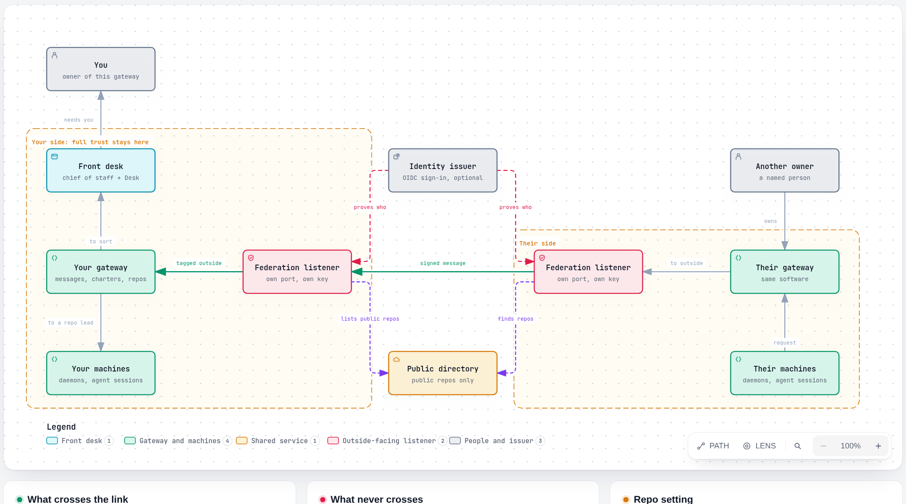
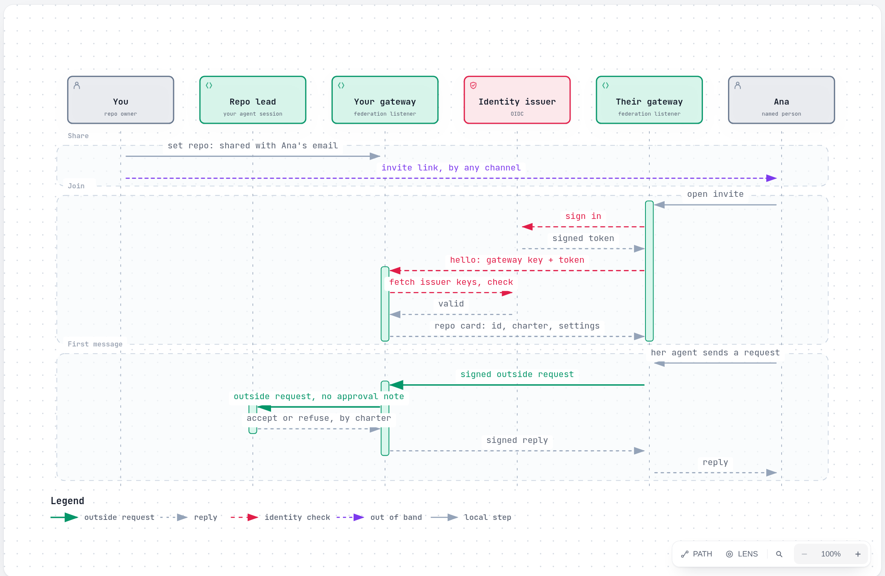
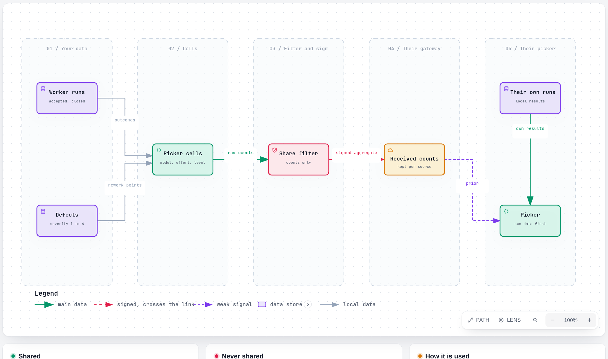

# 0178 - A network of gateways

Date: 2026-11-20

Status: Proposed, not scheduled. This is a design. Nothing is built from it while the recovery freeze of 2026-11-12 holds.

## Context

The owner asked how agent-net could become a network of gateways, starting from a conversation about what BitTorrent teaches: content-addressed identities, discovery without a central server, swarms, and later optional human identity (OIDC sign-in) and zero-knowledge proofs.

Today agent-net has one owner and one gateway. Every machine of the owner runs a daemon, and all daemons connect to that gateway. Everything inside is trusted as "the owner's own agents".

The owner decided these points on 2026-11-20:

1. Each repo has one of three settings: private (only me), shared with named people, or public. Private is the default.
2. Messages come first. A person with access to a repo can message it. They cannot start work on my gateway. They can start work on their own gateway.
3. If a repo is open to you, you can replicate it and copy its settings.
4. Some statistics are shared across the network, for example worker quality.
5. A gateway can be messaged as its human. This needs a front desk that sorts everything that arrives.

The design was discussed with the agent-net lead. Its answers are folded in below.

## Decision in short

- **Federation, not peer-to-peer.** Each owner keeps one gateway, as today. Gateways link to each other. Machines never talk to machines of another owner.
- **One identity, one master node.** In the owner's words, each identity has a master node and some child nodes. The master node is the gateway. The child nodes are that owner's machines, each running a daemon. Only master nodes talk to each other.
- **A foreign gateway is a new kind of peer.** It is closest to a connected app (0097): its own listener, its own credential, its own trust label. It is never a machine and never holds a machine token.
- **Messages only cross the link.** The federation listener has no operation that starts or wakes a session, or starts a worker. This is a property of the listener, not a setting.
- **One front desk.** Outside messages for the owner enter the front door of 0150, as one more source. There is no second desk.
- **Identity is optional and checked by signatures.** A gateway has a key. An owner may also sign in with an OIDC issuer. Other gateways check both signatures themselves.
- **Public discovery and zero-knowledge proofs are later stages.** Sharing with named people needs neither.

Diagram source (archify): [network.architecture.json](../design/gateway-network/network.architecture.json).

## What we take from BitTorrent, and what we leave

| BitTorrent idea | Here | Why |
|---|---|---|
| A torrent has an id made from its content, so anyone can check it | A repo has a signed **repo card** with a network id | A link to a repo can travel by any channel and still be checked |
| Magnet link | Invite link or repo link | One short string is enough to find and join |
| Piece hashes | Git already does this | A replicated repo is a git clone; git checks the content |
| Tracker, then DHT | A directory for public repos, later | Private sharing needs no discovery at all. A DHT is only worth its cost if one directory is not enough |
| Peers check everything themselves | Each gateway checks signatures itself | No gateway has to trust a middleman |
| Swarms that share pieces of the same work | Not taken | The owner chose messages only. Each gateway does its own work on its own machines and quota |
| Tit-for-tat, rarest-first | Not taken | They solve bandwidth sharing between strangers. That is not the problem here |

## Design

### 1. Gateway identity

Each gateway makes one key pair for federation. The public key is the gateway's network identity. It is separate from the CA and from machine enrollment, which stay as they are.

An id from another gateway (session, repo, message) always travels together with that gateway's key. It is never looked up in local tables as if it were local.

### 2. Human identity, optional

An owner may sign in on their gateway with an OIDC issuer, for example a Google account. The gateway then holds a signed token that says "this person, verified email".

When gateway B says hello to gateway A, it sends its gateway key and that token, and signs the whole hello with the gateway key. Gateway A checks two things itself:

1. The hello is signed by the key it claims.
2. The token is signed by the issuer. A fetches the issuer's public keys from the issuer's own published address.

If both hold, A knows that the holder of this gateway key signed in as this person, according to this issuer. The trust anchor is the issuer, the same as "Sign in with Google" on any website. Nothing else in the network has to be trusted.

Without sign-in, sharing still works: the owner shares with a gateway key instead of an email.

Rules:

- Tokens are short-lived. The hello is repeated when the token expires.
- The token is bound to the gateway key (the key's fingerprint is the nonce of the sign-in), so a copied token is useless on another gateway.
- Each owner chooses which issuers their gateway accepts.

### 3. Repo setting and discovery

Each repo carries one setting, kept in one place on the owning gateway:

| Setting | Who can see the repo card | How they find it |
|---|---|---|
| Private (default) | Nobody outside | Not at all |
| Shared | The named people or gateway keys | An invite link the owner sends by any channel |
| Public | Anyone | A repo link, and later a directory |

The **repo card** is a small signed record: the network id, the name, the purpose from the charter, the setting, and the git root commit so that two gateways can tell they hold the same code. The network id is a hash of the owning gateway's key and the repo identity of 0031.

The owning gateway decides on every request whether the caller may see the card. The answer for a repo the caller may not see is the same as for a repo that does not exist.

Charters are public inside one owner's network (0041). Outside it, a charter is visible only as far as the repo setting allows.

### 4. What access gives

A person who may see a repo can do three things:

1. **Send messages to the repo.** The message goes to the repo's lead as an outside request.
2. **Replicate the repo.** They clone the code with git, using the access the git host gives them. agent-net does not carry the code.
3. **Copy its settings** to their own gateway (section 7).

They cannot start work on the owner's gateway. Work happens on their own gateway, on their own machines and quota.

Diagram source (archify): [share-and-message.sequence.json](../design/gateway-network/share-and-message.sequence.json).

### 5. Outside messages

Today a message is an order, a request or advice (0089). An outside message gets a fourth label, set by the gateway from where the message came in, never from its body: **outside request**.

An outside request:

- never carries an approval note. "Your user approved", owner words (0087, 0165), delegated authority (0166) and peer trust (0013) do not apply to it, whatever its text says;
- is judged by the receiving lead under its charter. A charter can say what it accepts from outside. With nothing said, the lead may answer questions and must not do work;
- cannot wake a session by itself. It waits in the message store until the session is next active, or goes to the front desk.

Replies travel back the same way, signed by the answering gateway.

### 6. The front desk

A message addressed to a gateway, and not to one of its repos, is a message to its human. It enters the owner front door of 0150: the chief of staff sorts it and the Desk shows what needs the owner.

This is the same front door, with one more source. The chief sees the outside label and the checked identity of the sender ("Ana, verified by Google" or "unknown gateway, key ..."). It never treats an outside message as coming from the owner's own network.

Outside messages to a repo whose lead is not running also wait here.

The front desk depends on 0150, which is approved and not yet built.

### 7. Copy a repo's settings

These travel with a repo, because they describe the repo:

- the repo-level charter (purpose, accepts, refuses, rules);
- the project bar rules (0147);
- the skills the repo uses, by content hash from the skill archive (0169);
- the shape of the delivery pipeline (which steps).

These never leave a gateway, because they describe the owner or hold secrets: owner settings, notes and owner judgments, protected providers, picker floors and overrides, quota budgets, worker profiles, permissions and folder trust, MCP servers, connected apps, machine scopes, the merger, the CTO and chief settings, and graph edges to the owner's other agents.

A copy arrives as charter drafts (0088) and as proposed settings. The receiving owner sees each change and accepts it. Nothing is overwritten in place. Copied skills keep the hash of their source.

### 8. Shared worker-quality counts

A gateway may publish what it has learned about workers, if its owner turns this on.

Diagram source (archify): [shared-stats.dataflow.json](../design/gateway-network/shared-stats.dataflow.json).

- **Unit:** one row per picker cell (0161, 0173): harness, model with its version, effort, difficulty level.
- **Content:** number of runs, accepted, closed or rejected, rework points (the defect severities of 0103), and the time window. Raw counts, not rates, so that a receiver can combine them with its own.
- **Cost:** cost per accepted result at public list prices, never the owner's real spend.
- **Never shared:** brief text, repo or project names, session ids, timings tied to a machine, quota levels, spend.
- **Signed** with the gateway key. A receiver keeps counts per source, so one source can be dropped later.
- **Use:** a starting guess for cells where the receiver has little data of its own. Its own results replace the guess as they arrive.

A known defect must be fixed first. The schema audit of 2026-11-20 found that ratings and runs disagree on model, effort and difficulty for 542 of 744 ratings. Shared counts built on that would put results in the wrong cells.

### 9. Public repos and the directory

A public repo can be reached by anyone who has its link. A directory lists public repo cards so that they can be searched.

The first directory is a plain service that stores signed cards. Because the cards are signed by their gateways, the directory cannot forge one; it can only hide one. If that becomes a problem, several directories can exist, and only then is a DHT worth considering.

Public does not mean open for work. A public repo accepts outside requests like a shared one, and its charter still decides.

### 10. Zero-knowledge proofs

Not needed for the stages below. When an owner shares with a named person, the owner already knows the name, and the person proves it to that owner only.

A zero-knowledge proof becomes useful in one case: a repo shared with a group, where a member wants to prove "I am on the list" to other members without showing which entry they are. That can be added later on top of the same sign-in token, without changing the stages before it.

## What is reused, and what must not be stretched

Reused:

- The connected-apps path (0097, 0122, 0123): a separate listener that is off by default, a credential per party, refuse lists.
- The message store and delivery.
- The chief of staff and the Desk (0114, 0150) as the front desk.
- The repo identity of 0031 as the thing that is shared.
- Picker cells (0161, 0173) as the unit of shared counts.
- The way releases are signed (0061), as the model for signing.

Not stretched:

- **Enrollment and the CA.** A machine token is full trust. A foreign gateway never enrolls.
- **Peer trust (0013).** It means "my own agents may act without asking me". It never applies to an outside message.
- **The org tree and graph refs.** They describe the owner's own agents. A foreign repo is not a node in the tree. It lives in a separate list of remote repos.
- **Port 7420.** It stays off the internet (security.md). Federation has its own listener.

Decision 0001 D1 says the gateway is one process with modules. That stays true. This decision adds a second kind of peer to it.

## Risks

1. **An outside message that claims the owner's authority.** Handled by rule: the label comes from the listener, and no approval note is ever attached to an outside message.
2. **Spending the owner's money from outside.** Handled by structure: the federation listener has no operation that starts or wakes anything.
3. **Spam to the front desk.** Private is the default, so a gateway that shares nothing receives nothing. What a public gateway needs here is an open question below.
4. **A stolen sign-in token.** Tokens are short-lived and bound to the gateway key.
5. **Wrong shared counts.** Sharing is off by default, counts are kept per source, and the ratings defect is fixed first.
6. **Reach.** Two gateways must be able to reach each other. See the open questions.

## Stages

Each stage can ship alone and be used.

| Stage | What | Needs |
|---|---|---|
| 1 | Gateway key, federation listener, link two gateways by invite, repo setting, outside requests to a repo | Nothing else |
| 2 | Messages to a gateway through the front desk | 0150 built |
| 3 | Sign-in with an OIDC issuer, share with an email | Stage 1 |
| 4 | Copy a repo's settings as drafts | Stage 1 |
| 5 | Signed worker-quality counts | Stage 1, the ratings fix |
| 6 | Public setting and a directory | Stage 3 |
| 7 | Zero-knowledge membership proofs | Only if asked |

## Open questions for the owner

1. **Reach.** A gateway that receives must have an address others can reach. The apps listener already uses Tailscale Funnel for this. Is that acceptable for federation too, or should a gateway with no public address be able to take part by polling another gateway?
2. **Public and messages.** May anyone message a public repo, or only people who signed in? The design above lets anyone, with the charter deciding and the front desk sorting.
3. **The directory.** Who runs the first one: the owner, or nobody yet until a second owner exists?
