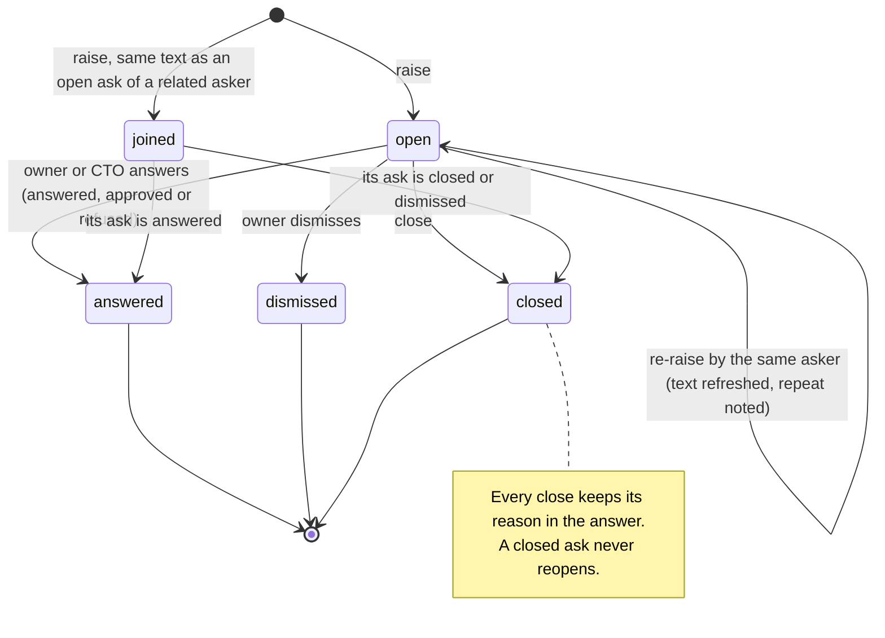
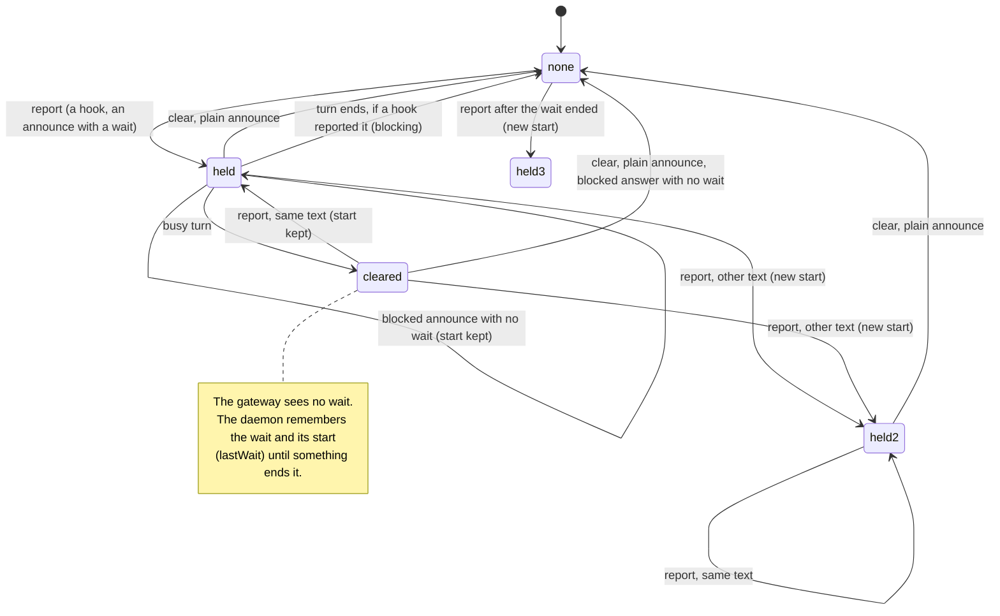
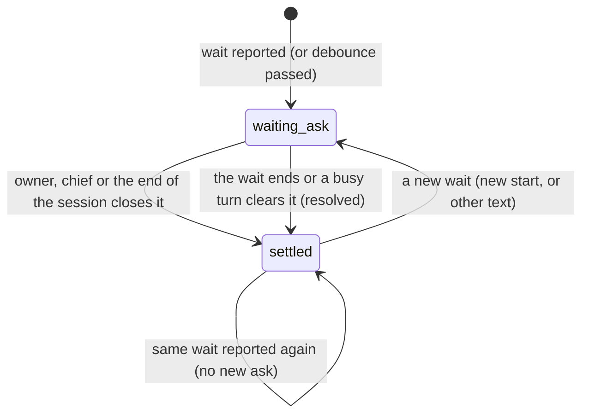

# Ask and wait lifecycle

This page is the state chart of an ask and of a session wait. It is the spec
that two property tests check. It describes what the code does today and
the rules it must keep. It does not add a rule.

Why it exists: the same few state machines gave the owner these bugs, each
found live and fixed one at a time.

| Bug | Fix |
|---|---|
| An announce closed approvals | ch_b1ef03bb |
| An identical wait raised a new ask every hour | ch_383b1a13, ch_1df063de |
| A busy turn reset the start of a wait | ch_383b1a13, ch_1df063de |
| A free-text answer to a held-start ask was lost | ch_96a9c820 |
| A blocked answer made a duplicate check row | ch_383b1a13 |
| A CTO message was accepted and never acted on | ch_23cb3581 |

The last two lines of the table are the edge of this page. The CTO delivery
confirm is a message-delivery machine, not an ask. It is not in the chart and
has no property here.

Code: `internal/gateway/store_inbox.go` (create, repeat rule, answer, archive),
`asks.go` (close, reconcile, waits), `check.go` (check answers),
`store.go` (`AnnounceNotify`, the session report), `chief.go` (sort, withdraw),
`internal/daemon/waiting.go` and `local.go` (the wait and the busy turn).

## An ask

One table holds every ask: `inbox_items`. The kinds that a session raises
itself are the question, the approval and the feature idea. The gateway raises
the waiting ask (a session waits for its user) and the check row (an idle check
was answered "blocked", or "more" with no wake). A step, a held request and the
rest follow the same chart. They add their own way to open and close.



A re-raise that finds a closed ask less than ten minutes old is not in the
chart: it opens nothing and joins nothing. It gets the closed ask back, so the
asker reads the answer.

### Events on an ask

| Event | What happens to an open ask |
|---|---|
| raise | A new row. The repeat rule may join it to an open ask first. |
| re-raise | The repeat rule: the same text (ids kept apart) from the same asker, or about the same thing, or from the same project and kind, within 24 h of an open ask, joins it. A closed ask catches it for 10 min. |
| announce, no wait | A **question** raised before the session's earlier announce closes (`moved_on`). **An approval never closes here.** A check row closes (`resolved`). |
| announce, with a wait | Closes no question and no approval. The wait it carries goes to the daemon and the gateway as a report. |
| blocked answer | Closes nothing. It may add one check row. See "A blocked answer" below. |
| done answer | Closes the check row of the session (`done`). |
| busy | The session reports no wait: its waiting ask closes (`resolved`). |
| owner answer | open to answered, approved, refused or dismissed. Joined rows follow. |
| owner types in the asking session | A question, an approval and a check row of that session close (`owner_replied`). The text is the decision. |
| chief sort | close (reason `chief: ...`), merge, withdraw, send, send to the owner. |
| withdraw | By the asker, or by a session that relayed it: closed with `<asker>: <reason>`. |
| merge or join | The ask joins another open ask. It is answered with it. |
| session archive | `question`, `approval`, `feature_idea`, `waiting`, `session_stall` and `check` of that session close (`session_archived`, `session_ended`). |
| daily tick | The 24 h repeat window of an open ask ends. A held request expires. The minute reconcile runs: it closes asks of ended sessions and of done changes, and opens the asks of waits that outlived the debounce. |

### Close reasons

A closed ask keeps its reason in the answer column. The reasons are
`withdrawn`, `replaced`, `change_done`, `session_ended`, `resolved`, `expired`,
`activity_or_end`, `owner_replied`, `moved_on`, `moved_on (cleanup)`, `answered`,
`moved_to_log`, `flushed_by_front_door`, `grouped`, `signed_in`, `returned`,
`slept`, `session_archived`, `done`, and the free text `<who>: <why>` of a
chief close or a withdraw.

### Rules for an ask

1. An approval is ended only by the owner or CTO answer, the asker's withdraw,
   the chief, the owner typing in the session, or the end of its session. An
   announce, a busy turn and a tick never end one.
2. An answered, dismissed or closed ask never goes back to open.
3. Every closed ask has a reason.
4. A session has at most one open check row. A repeat updates it.

## A session wait

A session that waits for its user reports a wait: a kind, a text and a start
(`Since`, whole seconds). The daemon holds it. The gateway stores it on the
session and raises the **waiting ask** `waiting:<session>` for it.



`held2` and `held3` are a different wait from `held`: a new start. The chart
draws them apart so the arrows read.

### The start of a wait

The start of a wait does not move while its text is unchanged:

* A report with the same text as the wait now held keeps its start.
* A report with the same text as the wait a busy turn cleared keeps its start.
  The turn clears the wait (decision 0016) but the session still waits on the
  same question after it.
* A report with another text starts a new wait now.
* A clear, a plain announce, or the end of a turn that a hook-reported wait
  blocked, ends the wait. The same text after that is a new wait.
* A blocked answer ("blocked", "blocked on ...") keeps the wait the session
  still holds. When a busy turn cleared it first, the answer has no wait to
  keep and ends it.

The gateway also keeps a start: a re-report of the same kind and text without a
start, for example from a daemon that restarted, keeps the stored start.

### The ask of a wait

The gateway keeps one waiting ask for a wait. It is raised when the wait
outlived the debounce (2 min), or at once when the owner is not in the session.
`waitAlreadySettled` is what stops it from being raised again: a wait whose ask
was created at or after its start, and then answered or closed, is not raised
again. A new start (a new wait) can raise it again.



### A blocked answer

The hourly idle check asks the session what it is doing. The answer is read
from the next announce task line: `done`, `more ...` or `blocked [on ...]`.

A "blocked" answer makes a check row ("X is blocked on ...") **unless the wait
it repeats already has an ask**, open or settled. The wait the announce carries
is the one it answers with. With none, the stored wait is the fallback. A busy
turn may have cleared the stored one before the answer arrived, so the announce
comes first.

## Rules for a wait

5. One open waiting ask per session wait.
6. A wait that is reported again with its start never raises a second ask after
   its ask is settled. In one stretch of the same wait, at most one waiting ask
   is created.
7. The start of a wait does not move while its text is unchanged (the daemon),
   and the gateway keeps the start the daemon reports.
8. A blocked answer that repeats a wait that has an ask adds and changes no
   check row.

## The property tests

Two tests apply random event sequences and check the rules after every step.
Both use fixed seeds, plus one random seed that is printed on failure.

| Test | What it drives | Rules |
|---|---|---|
| `TestAskLifecycleProperty` (`internal/gateway/asklife_property_test.go`) | A real store on a fake clock. Events: raise a question or an approval, answer, withdraw, chief close, announce (plain, blocked, done, more, with or without a wait), the daemon's wait report, busy, an idle check, the owner typing, a session archive, time passing with the minute reconcile. | 1 to 6 and 8 |
| `TestWaitLifecycleProperty` (`internal/daemon/waitlife_property_test.go`) | A real daemon and gateway, through the plugin calls of a Pi session: hook wait, announce with a wait, blocked answer, plain announce, busy, idle, clear. | 7 |

A failure prints the seed, the step, the broken rule and a short event list.
The list is cut down by removing every event that is not needed. Paste it into
`TestAskLifecycleReplay` or `TestWaitLifecycleReplay` to keep it as a regular
test.

Run them:

```
go test ./internal/gateway -run '^(TestAskLifecycleProperty|TestAskLifecycleReplay)$'
go test ./internal/daemon  -run '^(TestWaitLifecycleProperty|TestWaitLifecycleReplay)$'
AGENT_NET_PROPERTY_LONG=1 go test ./internal/gateway -run '^TestAskLifecycleProperty$' -timeout 30m
AGENT_NET_PROPERTY_SEED=17 go test ./internal/gateway -run '^TestAskLifecycleProperty$' -v
```

The default run is a few seconds. `AGENT_NET_PROPERTY_LONG=1` runs many more
seeds and steps. `AGENT_NET_PROPERTY_SEED` runs one seed, to replay a failure.

### What the tests do not cover

* The CTO delivery confirm (ch_23cb3581): a message machine, not an ask.
* Held-start answers (ch_96a9c820): the free text of one kind of ask. It has
  its own tests.
* The asks of a delivery step, a charter draft and a learned suggestion. They
  open and close by their own sources.
* A chief that is live. The store has no chief in these tests, so no ask goes
  to a lead or a holder.

### Known findings

The tests found two current behaviours that break a rule. They are not fixed
here. Each has its replay. The tests let them pass, with a named exemption at
the check, so the default run stays green. Remove the exemption with the fix.

* **F1: a duplicate of a dismissed ask is closed with no reason.** An ask that
  joined another open ask is settled with it by the trigger
  `inbox_items_joined_settle`. When the owner dismisses the first ask, the
  trigger closes the joined row and copies the empty answer. Rule 3 holds for
  every closed ask except these joined rows. The exemption is the `dupOf` test
  in `check` (`asklife_property_test.go`). Replay (gateway test, seed 6 finds
  it in 9 steps):

  ```
  {"ask", 0, 0, 0}, {"ask", 1, 0, 0}, {"wait", 0, 0, 1}, {"ask", 2, 1, 0}, {"answer", 0, 3, 2},
  ```

* **F2: the same wait text reported by the other source moves the start.** A
  session announces a wait, then a harness hook reports a wait with the same
  text (or the other way round). `setWaiting` compares the whole report with
  `sameWaiting`, and the two reports differ in `Blocking`, so it takes the hook
  report for a new wait and gives it a new start. The gateway then sees a new
  wait: if the first ask was settled, it raises a second one. Rule 7 says the
  start stays. The exemption is the `fresh` mark in `waitModel.report`
  (`waitlife_property_test.go`). Replay (daemon test, 2 events):

  ```
  {"announce", 0}, {"hook", 0},
  ```

### What the teeth tests showed

With each past bug put back for one run, the default run found it. Seeds are
the fixed seeds of the default run. "Step" is the event of the seed that broke
the rule, and the replay was then cut down to the events shown.

| Bug put back | First seed that fails | Found at step | Replay after the cut |
|---|---|---|---|
| An announce closes approvals | 1 | 59 | 3 events |
| A busy turn forgets the wait it cleared (daemon) | 3 | 9 | 3 events |
| A blocked answer makes a check row for a wait that has an ask | 2 | 81 | 3 events |
| A settled wait is raised again (`waitAlreadySettled` off) | 1 | 32 | 9 events |
