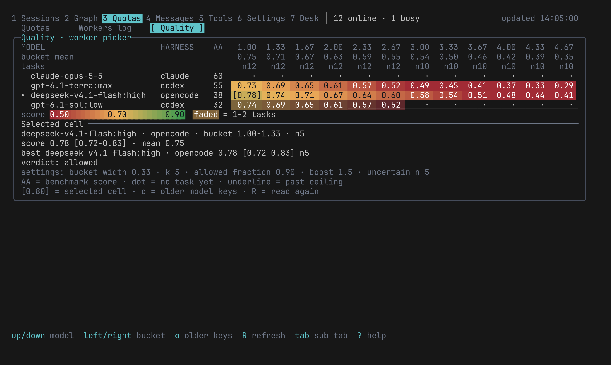
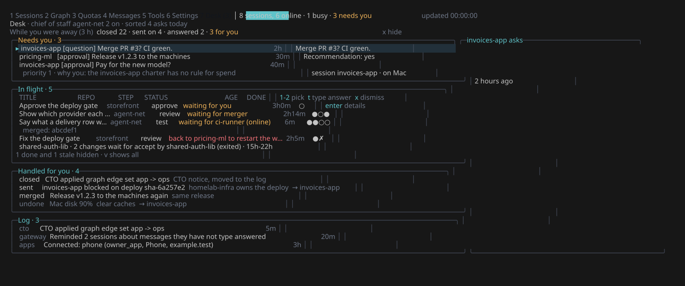
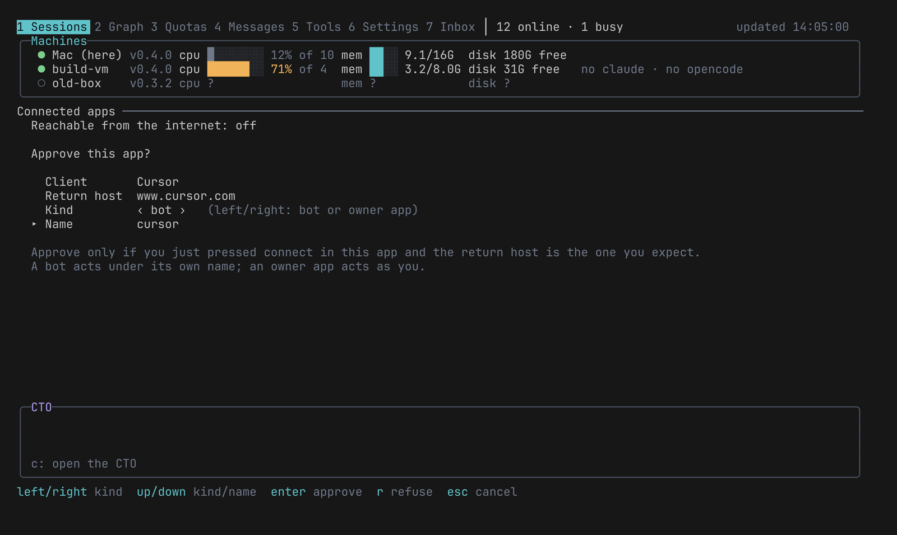

# A tour of agent-net

The screens of the TUI and what you can do on each. For what agent-net is and why, read the [README](../README.md).

`agent-net` opens the TUI. It has seven tabs: **1** Sessions, **2** Graph, **3** Quotas, **4** Messages, **5** Tools, **6** Settings, **7** Desk. `?` lists the keys of the screen you are on.

## Sessions and messages

Every session on every machine, with its agent, project, model, status, CPU and memory. Enter opens a session live: its prompts, replies and tool calls. Messages (tab 4) shows what the agents say to each other.

Ask an agent things like:

- "Ask the Pi session on the build VM which port its dev server uses."
- "Tell the billing and invoices sessions that shared-auth v2.3 renames `user_id` to `account_id`."

The message enters the other session as a new turn, labelled with its sender, and the reply comes back into your conversation. Agents answer each other without waiting for you; they still ask you before risky or out-of-scope work. Per session, the RULE cell sets how requests from other agents are handled (`normal`, `ask` or `auto`), and the DELEGATE cell sets who does the coding: the session itself, a native subagent on a cheaper model, or workers. See [delegation policy](reference.md#delegation-policy).

## Workers

Ask an agent to "do this with a worker". It calls `agent_worker_start` with a brief, and agent-net:

1. **Scores the brief.** A cheap judge rates six things (reasoning, scope, coupling, uncertainty, verification, risk) from 1 to 5. A fixed formula turns them into a level, from `trivial` to `very_complex`. The agent tells you the result in one line, and the Claude workers panel shows it next to the worker.
2. **Picks a model.** Among the worker profiles you registered, it keeps the ones good enough for that level, prefers providers that are behind their quota pace, keeps the protected ones (your orchestrator's subscription) for last, and rotates so no model takes every task.
3. **Starts the worker** in its own git worktree by default. Codex workers and Antigravity workers are sandboxed by their own sandboxes. On Linux, Pi and OpenCode workers run in bubblewrap when the project has the OS sandbox on (`workers.os_sandbox` in `node.json`). Otherwise Claude, Pi and OpenCode workers run with the owner's permissions. See the roadmap.
4. **Sends a notice** when the worker ends: status, run time, tokens, the branch and the diff stat, with the worker's report. The calling agent reviews the diff and runs the tests before it tells you the work is done.

Each task's outcome is recorded: nudges, fixes, and bugs found later. Those outcomes become a score for each model at each difficulty level. The Quality sub-tab (tab 3, then Tab) shows the picker exactly as it decides: one row per model, one column per difficulty level, and for the selected cell its score, its range, the number of tasks and the verdict (allowed or not).

<p align="center">
  
</p>

Quotas (tab 3) also shows each subscription's usage and pace. Details: [workers](reference.md#workers), [subscription quotas](reference.md#subscription-quotas).

## The graph and the CTO

The Graph (tab 2) is the map of your agents: each project node has a charter (what it does, what it accepts and refuses), and edges set the rules between them. A `depends` edge says who may ask whom, and whether requests run without asking (`auto`), wait for you (`ask`) or are refused (`never`). A `deploys` edge lets one agent ship another's project.

The CTO is an agent that runs the network for you. Press `c` and ask it in plain words: add a machine, draft a charter, set an edge, start a worker. Changes apply at once and leave an Inbox notice with an undo key where one is possible. Only removing a node, repo or machine, and rotating a machine token, wait for you as proposals. Your own login and OAuth consent stay with you: the CTO sends a one-click prompt.

## Desk

<p align="center">
  
</p>

Everything that waits for you, and every change in flight, is on one screen, the Desk (tab 7): CTO proposals, sessions that ask you a question or stopped with work left, and written approvals. The tab shows the count. Select an item and approve or refuse it there. See [owner inbox](reference.md#owner-inbox-and-written-approvals).

## Connected apps

Cloud agents (for example Grok Bot) and your phone can use agent-net through MCP over OAuth. The app shows a code; you approve it in the TUI (Settings, tab 6), as a **bot** that acts under its own name with a small set of tools, or as an **owner app** that acts as you. Internet access is off until you turn it on; with Tailscale, agent-net sets up the Funnel route for you, and `agent-net setup --gateway --apps-tailscale-name agent-net` gives it a Tailscale name of its own.

<p align="center">
  
</p>

See [connected apps](reference.md#connected-apps).

## Skills and MCP servers

Tools (tab 5) lists every skill and MCP server found on every machine, including the ones agent-net did not install. Turn one on for every project, for some projects, or for one machine; compare two copies of a skill and keep one; remove or restore. Filter with `node:`, `project:` or `machine:`, or press `t` on a node in the Graph to see what that agent gets. Every change is a plan you can undo. Details: [decision 0027](decisions/0027-skills-and-mcp-management.md).

Add an MCP server once, and sessions on every machine can use its tools. Tokens stay on the machine that hosts it.

```
agent-net mcp add homelab --url http://10.0.0.5:8000/mcp \
  --header-file 'Authorization=~/.secrets/homelab'
agent-net mcp list
```

Its tools appear in every session as `homelab__<tool>`, its prompts as `homelab__<prompt>`, and its resources as `agent-net://homelab/<uri>` (in Claude Code: `ListMcpResources`). Details: [docs/mcp-registry.md](mcp-registry.md).

